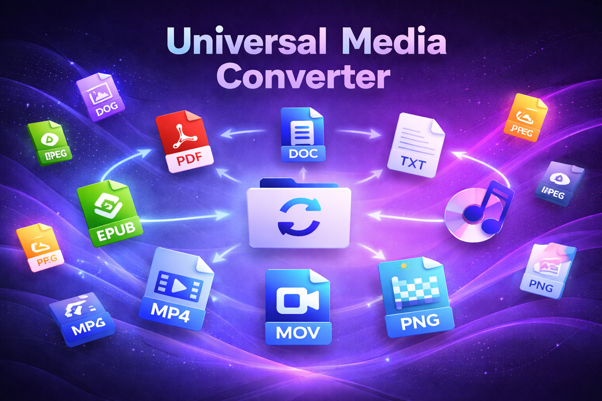

# AnyConvert (Universal Media Converter)

**On-device file converter for Android** — documents, images, video, and audio. Pick a file, choose a target format, save or share the result. No uploads, no account required.

**Package:** `ab.inque.converter` · **Version:** 0.1.1 (21) · **SDK:** min 27 / target 35



---

## What it does

AnyConvert converts between **26 formats** across four categories. The UI offers up to **~600 source→target pairs** on a fully capable device (on-device speech recognition, modern API). Every pair shown in the dropdown has a shipped code path.

| Category | Examples | Cross-format tricks |
|----------|----------|---------------------|
| **Documents** | PDF, DOCX, EPUB, TXT, RTF, HTML | Read aloud (TTS), scan-to-text (OCR) |
| **Images** | JPG, PNG, WEBP, HEIC, BMP, TIFF | → PDF, → documents (OCR), slideshow → video |
| **Video** | MP4, MOV, MKV, WEBM, AVI, GIF | Extract audio, frame capture, transcribe (STT) |
| **Audio** | MP3, WAV, M4A, OGG, FLAC | Transcribe to documents, waveform → image/video |

Some conversions are **creative transforms** by design (e.g. photo → Word = OCR text, video → PDF = frame images). Others are **simplified fidelity** (e.g. HTML → Word loses layout). The app labels these honestly; they are not missing features.

**Privacy:** all processing runs on the device. Files are picked via the system document picker (SAF) and never sent to a server.

---

## App experience

- **Pick & convert** — SAF file picker, format dropdown driven by a conversion planner
- **Batch mode** — multiple files of the same type; optional ZIP output; images → PDF merges pages
- **Media tools** — trim, speed, flip, rotate (video/audio); optional resize & quality presets
- **Background jobs** — foreground service with notification and cancel
- **Link import** — paste a URL to fetch a page or direct media (YouTube limited on-device)
- **Monetization** — free tier uses conversion points + rewarded ads; one-time Premium unlock

---

## Architecture (high level)

```
LandingActivity → MainActivity → ConverterViewModel → ConversionForegroundService
                                                          │
                                                          ▼
                                              UniversalConverter.convertFile()
                                                          │
                    ┌─────────────────────────────────────┴──────────────────────────┐
                    │  ConversionPlanner (BFS) + ConversionPipeline (multi-hop)       │
                    │  FormatCapabilities / FormatSniffer / FfmpegVideoExporter       │
                    └────────────────────────────────────────────────────────────────┘
```

| Layer | Key modules |
|-------|-------------|
| UI | `MainActivity`, `LandingActivity`, `PurchaseActivity` (ViewBinding + XML) |
| State | `ConverterViewModel`, `ConversionPrefs`, `MediaToolOptions` |
| Engine | `UniversalConverter`, `PdfConverter`, `DocxConverter`, `EpubConverter` |
| Pipeline | `ConversionPlanner`, `FormatCapabilities`, `OcrHelper`, `GifEncoder` |
| External | iText 7, Apache POI, ML Kit OCR, FFmpeg-Kit (MKV/AVI remux), TAndroidLame (MP3) |

Heavy work runs on `Dispatchers.IO`. Temp files live in `cacheDir` and are cleaned up after each job.

---

## Project layout

```
unimediaconv/
├── app/src/main/java/ab/inque/converter/   # App & conversion engine
├── app/src/test/                           # JVM unit tests + doc generators
├── app/src/androidTest/                    # On-device tests + fixtures
├── scripts/run_all_tests.ps1               # Unit + instrumented test runner
├── backend/                                # Optional dev server (yt-dlp proxy)
└── DOCS.md                                 # → canonical docs in Work/skills/
```

---

## Build & test

**Requirements:** Android Studio, JDK 11+, Android SDK 35

```powershell
# Debug build
.\gradlew :app:assembleDebug

# Unit tests (planner, capabilities, doc generators)
.\gradlew :app:testDebugUnitTest

# Full suite (unit + device tests; phone/emulator required)
.\scripts\run_all_tests.ps1
```

Instrumented fixtures include `app/src/androidTest/assets/conversions/test.mp4` and sample documents.

---

## Documentation

Planning, product specs, QA matrices, and the Cursor agent skill live **outside this repo**:

**`Work/skills/unimediaconv/`** — see [DOCS.md](DOCS.md) for the full index.

| Doc | Purpose |
|-----|---------|
| `FEATURES.md` | Product specifications |
| `FEATURES_MATRIX.md` | Technical conversion matrix (auto-generated) |
| `GAPS.md` / `PLAN.md` | Open gaps & roadmap |
| `TEST_PLAN.md` | QA & sign-off checklist |
| `SKILL.md` | AI / developer context |

Regenerate auto-docs from repo root:

```powershell
.\gradlew :app:testDebugUnitTest --tests ConversionFeaturesDocGeneratorTest
.\gradlew :app:testDebugUnitTest --tests GapsDocGeneratorTest
```

---

## License & distribution

Android app project for Play Store distribution. See app module and `google-services.json` for Firebase/AdMob/Billing configuration.
